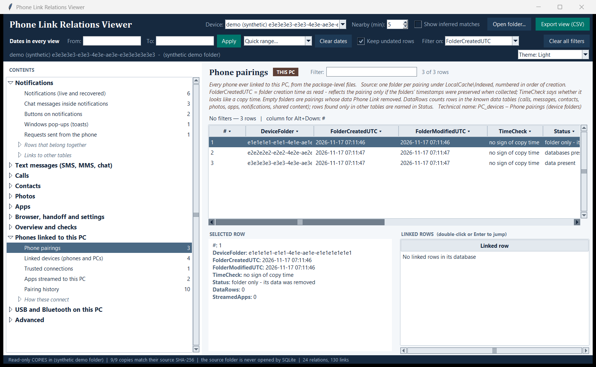
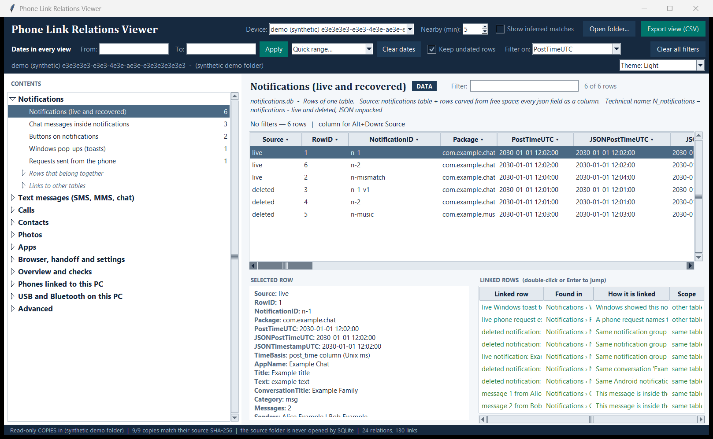
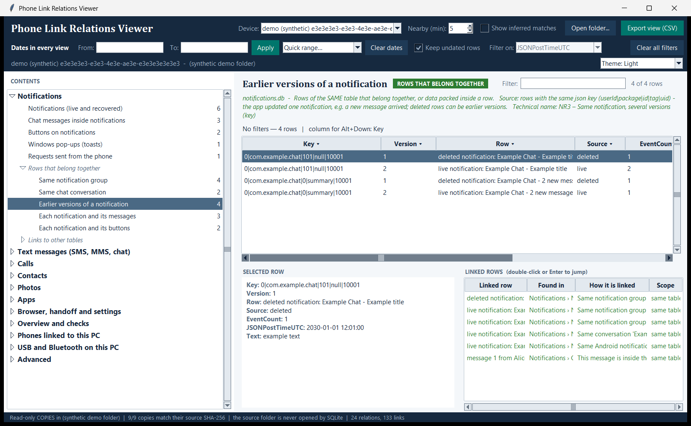
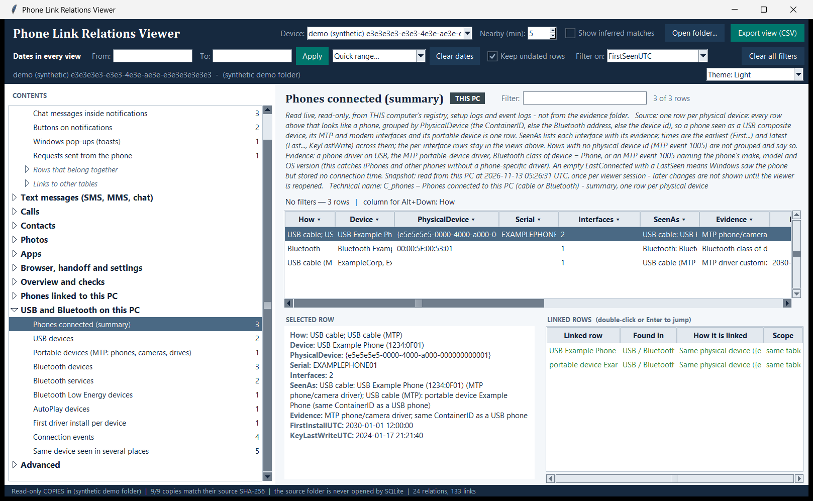
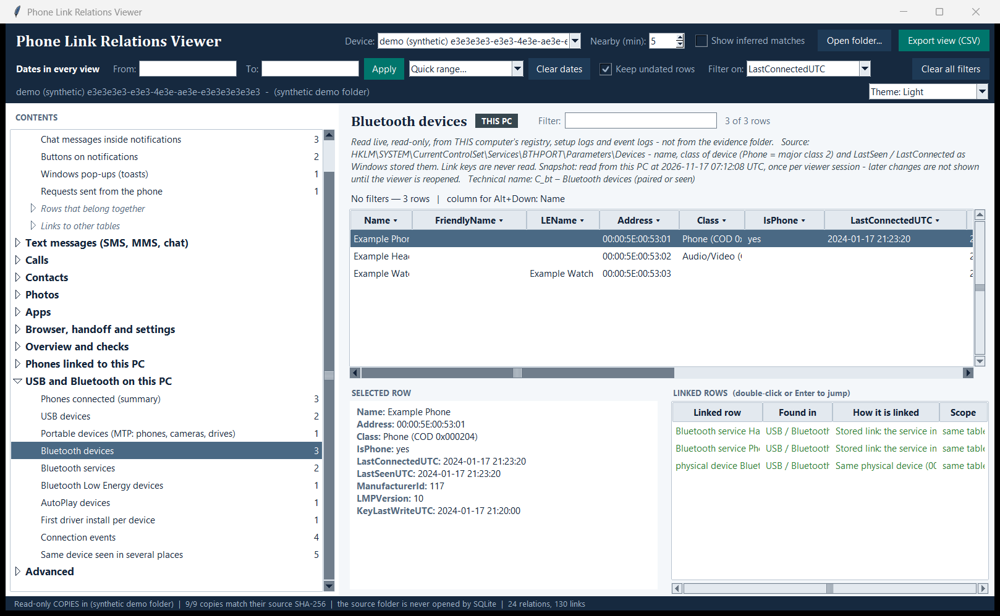
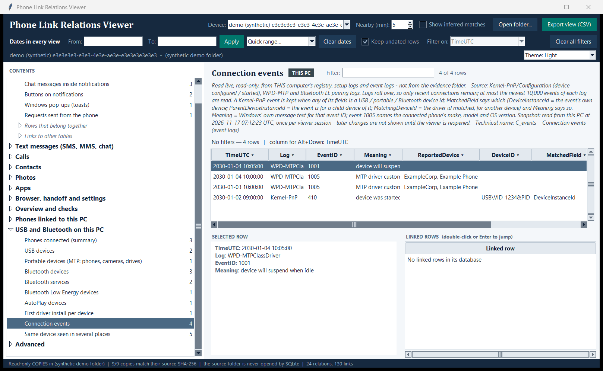
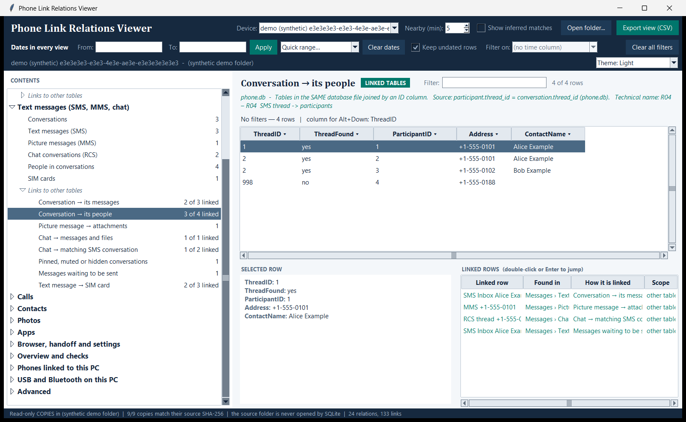
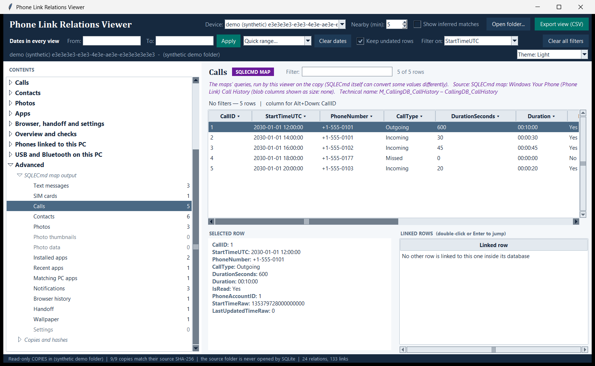

# Phone Link forensics

[](https://github.com/KotlaAvinash/phone-link-forensics/actions/workflows/tests.yml)

Forensic tooling for **Microsoft Phone Link** (formerly *Your Phone*), the Windows app that mirrors an Android phone's messages, calls, photos, notifications and apps onto a PC. It also covers the other ways a phone leaves traces on a PC: **USB cable** and **Bluetooth**.

The repository has two parts:

| Part | What it is | For |
|---|---|---|
| [`maps/`](maps) | Five **SQLECmd maps** (one fix, four new) | Running inside Eric Zimmerman's [SQLECmd](https://github.com/EricZimmerman/SQLECmd) / KAPE to turn the Phone Link databases into CSV |
| [`viewer/`](viewer) | A **desktop viewer** (Python, standard library only) | Exploring the databases, recovering deleted rows, and following how rows relate to each other |

All screenshots and test data in this repository are **synthetic** (example names, `555-01xx` numbers, documentation-range addresses). No real phone's data is included.

---

## Contents

- [Screenshots](#screenshots)
- [Quick start](#quick-start)
- [The viewer](#the-viewer)
  - [How evidence is handled](#how-evidence-is-handled)
  - [The window](#the-window)
  - [Linked phones (this PC)](#linked-phones-this-pc)
  - [Phone connections: USB cable and Bluetooth (this PC)](#phone-connections-usb-cable-and-bluetooth-this-pc)
  - [Where Windows stores phone connection traces](#where-windows-stores-phone-connection-traces)
  - [The Phone Link databases](#the-phone-link-databases)
  - [notifications.db in detail](#notificationsdb-in-detail)
- [The SQLECmd maps](#the-sqlecmd-maps)
- [Tests](#tests)
- [Limitations](#limitations)

---

## Screenshots

The **Contents** list on the left uses plain names grouped by topic, with each view's row count on the right. Every screenshot uses the synthetic demo data.

**Linked phones**: every phone ever linked to this PC through Phone Link, including pairings whose data was removed. The panel on the right shows how a pairing connects to its phone details and streamed apps.



**Notifications (live and recovered)**: rows recovered from free pages are marked `deleted`, and notifications rebuilt from JSON that survived its record header are marked `json-carved (record header lost)`. The packed JSON is unpacked into columns, and every linked row (group, conversation, older versions, chat messages, buttons, Windows toast, phone request) is listed on the right.



**Rows that belong together**: *Earlier versions of a notification*. Here a deleted row is the earlier version of a live one.



**Phones connected by cable or Bluetooth**: one summary of every phone trace on this PC, with the evidence for each.



**Bluetooth devices**: name, class of device, LastSeen and LastConnected, linked to the services the device offered.



**Connection events**: event-log entries with Windows' own meaning for each event ID. MTP event 1005 names the connected phone's make, model and OS version.



**Links to other tables**: *Conversation → its people*, under Text messages (joined inside `phone.db`).



**SQLECmd map output**: the maps' queries, run by the viewer on the same database (SQLECmd itself can convert some values differently; see *SQLECmd behaviours to know*).



---

## Quick start

Requirements: **Python 3** on Windows (Tkinter ships with Python). Nothing to install for the viewer. CI tests **Python 3.12 on Windows only**. The code uses no syntax newer than Python 3.8, but other Python versions are not tested.

```bash
# 1. Try it on synthetic data - nothing real is read
python viewer/plmapview.py --demo

# 2. One device folder (for example a collected evidence folder)
python viewer/plmapview.py --input "<...>\LocalCache\Indexed\<device GUID>\System\Database"

# 3. Everything on this PC: all Phone Link pairings, plus phones connected by USB cable or Bluetooth
python viewer/plmapview.py --input "%LOCALAPPDATA%\Packages\Microsoft.YourPhone_8wekyb3d8bbwe"

# 4. Add the cable / Bluetooth section explicitly for any input
python viewer/plmapview.py --input "<folder>" --this-pc
```

Phone Link's default location on a PC:

```
%LOCALAPPDATA%\Packages\Microsoft.YourPhone_8wekyb3d8bbwe\LocalCache\Indexed\<device GUID>\System\Database\
```

That folder holds `phone.db` (SMS, MMS, RCS), `calling.db` (calls), `contacts.db`, `photos.db` (photo index), `phoneapps.db` (installed apps), `notifications.db`, `continuity.db`, `deviceData.db` (wallpaper) and `settings.db`, each with its `-wal` and `-shm`.

---

## The viewer

### How evidence is handled

- **Copies only.** The input folder is copied to a temporary folder first: every `.db` with its `-wal` and `-shm`, plus the package files for *Linked phones*. The copies go to new `plrelate-*` and `pldevices-*` folders in Python's temp folder (the first of `TMPDIR`, `TEMP`, `TMP` that is set, normally `%LOCALAPPDATA%\Temp` on the system drive). To keep them off a drive you are examining, point `TEMP` at a folder on an external drive before starting (and leave `TMPDIR` unset, or set it to the same folder): `set TEMP=E:\plwork`.
- **A steady snapshot.** A live database can change while its `.db`, `-wal` and `-shm` are copied one after another. The `.db` and `-wal` are hashed before and after each set, and a set that changed is copied again (up to 3 tries). A source that never settles is still loaded, with a warning in the status bar, because a busy live source cannot be frozen without administrator rights. Its rows in **Copies and hashes** say `source changed during copy`, show no source hash (there is none to claim) and give the copy's own hash instead. Treat that copy as possibly mixing two moments.
- **Every copy of a steady source is re-hashed (SHA-256) against its source.** A mismatch stops the load, and the bad copy is removed.
- **Read-only.** Copies are opened with SQLite `mode=ro` and `query_only`. The source folder is never opened by SQLite.
- **Deleted rows are carved from the copy** (`plcarve.py`): free pages, freeblocks, page slack and WAL frames. A record is recoverable only while its header survives, and a typical single-row delete overwrites it, so most recoveries come from whole free pages, page slack and WAL frames. A long value is only partly on the page itself (the rest is on overflow pages, which are not read), so a carved value cut at that boundary is marked `value cut - rest was on overflow pages (not read)` instead of looking complete. If the live rows of a table cannot be read, its carved rows are labelled `unknown - live rows unreadable` rather than `deleted`. **Notifications get a second pass:** a deleted notification's JSON often survives after its record header is overwritten, so `notifications.db` (and its WAL) is also scanned for complete JSON objects with `packageName` and `key`; each is recovered once (deduplicated against live and carved rows), marked `json-carved (record header lost)`, and its time is decoded by its own rule (`postTime` in the JSON is Unix milliseconds, the table's `post_time` is FILETIME; the **TimeBasis** column says which one a row's time came from). Rows of WAL page versions that a later frame replaced are also decoded and marked `wal-superseded`.
- **Cleanup.** Copies are deleted when the window closes. If a copy cannot be removed, the viewer says so and shows the path. On start it reports copy folders left by earlier runs.
- **Secrets are never read.** Not read: the Bluetooth link keys, `PlatformEncryptedKeyStorage.json` and certificate bodies (only counted).
- **Folder links are not followed.** When the Phone Link package is copied, a symlink or junction is skipped, not followed, and is listed in **Linked-phone copies and hashes** as `skipped - symlink or junction, not followed`.
- **Read-only access to the live PC.** The cable / Bluetooth section reads the live registry and logs (event logs through `wevtutil`) and writes nothing to them.
- **Running on a suspect PC is live response.** The viewer never writes to the source files it copies (reading them can still update their last-access time where Windows records it), but running it on the machine under examination still changes that machine: the temporary copies are written to its temp folder (by default on the system drive, where new files can overwrite unallocated space that may still hold deleted data), and starting Python (and `wevtutil` for the cable / Bluetooth section) leaves Prefetch and other execution traces. Picking a theme in the window also writes `%APPDATA%\phone-link-forensics\viewer.json` (never with `--demo` or `--screenshot`), and *Follow Windows* reads `HKCU\Software\Microsoft\Windows\CurrentVersion\Themes\Personalize`. Prefer collecting the Phone Link package first and running the viewer with `--input` on that collected copy, on your own workstation. If you must run it on the suspect PC, redirect `TEMP` to an external drive as above and record what you ran and when.

### The window

- **Left: Contents.** Plain-English names grouped by topic, each with its row count on the right:
  - **Notifications** (open when the window starts), **Text messages (SMS, MMS, chat)**, **Calls**, **Contacts**, **Photos**, **Apps**, **Browser, handoff and settings**
  - **Overview and checks**: the timeline, calls and texts per person, and the checks
  - **Phones linked to this PC** and **USB and Bluetooth on this PC**
  - **Advanced**: the SQLECmd map output, and the copies with their hashes
  - Inside a topic the data comes first. **Rows that belong together**, **Links to other tables**, **Matched from other files (inferred)** and, under *Phones linked to this PC*, **How these connect** are folded sub-headings; *Advanced* holds **SQLECmd map output** and **Copies and hashes**. A greyed name has no rows.
  - Opening a view puts its technical name (view code, database and table) in the banner, so nothing technical is hidden.
  - Counts are honest about what they count: a filtered view shows **112 of 686**, a check shows its problems (**2 issues / 28**), and a relation whose rows include unmatched ones shows **69 of 91 linked**.
- **Middle: the table, with Excel-style column filters.** The banner above it says what the view is and where its data comes from. Every column heading has a **▾**: click it (or press **Alt+Down**) to open a panel like Excel's AutoFilter:
  - **Sort**, worded for the column's type: *A → Z / Z → A* for text, *Smallest → Largest* for numbers, *Oldest → Newest* for dates. Blanks always sort last.
  - **Clear filter from "column"**.
  - **Condition**: text *contains / does not contain / equals / begins with / ends with*; numbers *equals / does not equal / greater than / less than / between*; dates *on / before / after / between*, with quick ranges (*24 h / 7 days / 30 days*) counted back from the **newest date in that column** - evidence is usually old, so never from today.
  - **Search** the column's values, then tick or untick them in a list with each value's row count, **(Select All)** and **(Blanks)**. Date columns are grouped Year ▸ Month ▸ Day. Up to 10,000 values are listed (search still covers all of them).
  - **OK / Cancel** (Enter / Esc).
  - Filters on several columns combine (AND), a filtered heading shows **●**, and a line above the table states every active filter and the sort. Filters stay with each view when you switch views. **Rows with no value or no date are kept unless you untick (Blanks) yourself** - a condition never hides them silently, because an undated row can still be evidence.
  - The **Filter** box above the table searches every column at once.
  - Invisible characters are shown, not hidden: a name made of the invisible U+200E mark (seen on a real phone) appears as `⟨U+200E⟩`. Filtering, sorting and export use the raw value.
- **Bottom left: the selected row**, all fields. For a notification the raw JSON is shown underneath.
- **Bottom right: linked rows.** Each line shows *which* row is linked, *where* it is found (topic › view), *how* it is linked (in plain words), and whether it's in the same table, another table of the same database, or another database. **Double-click a line to jump to that row.**
- **Top bar:**
  - **Device**: the phone (pairing folder) to show, when the opened folder holds more than one.
  - **Show inferred matches**: off by default, because matches across database files are the tool's inferences (numbers matched on their last 10 digits, package names, times). With it off, the timeline and *calls and texts per person* views are hidden too, because they merge several databases.
  - **Nearby (min)**: the window (1-1440 minutes, default 5) for *events within N minutes of each other*. A wider window finds more pairs and more of them are coincidence; times are the phone's own clock.
  - **Dates in every view** (second row): **From / To** (`YYYY-MM-DD` or `YYYY-MM-DD HH:MM[:SS]`), a quick range, **Filter on** (which time column of the current view), **Keep undated rows** (on by default) and **Clear all filters**. It applies to every view; the column filters apply on top.
  - **Theme**: Light / Dark / Follow Windows (also **Ctrl+Shift+L**, or `--theme light|dark|system`). Every text colour meets WCAG AA contrast (4.5:1) in both themes, colours that carry meaning stay distinct, and the window title bar follows the theme. The choice is remembered (see *Running on a suspect PC*).
  - **Open folder…** opens another case: the linked-phone views follow the new folder, and the live USB / Bluetooth views are hidden (with a note saying why) unless the new folder is this PC's own Phone Link package or `--this-pc` was given.
  - **Open folder…** and **Export view (CSV)**. The export is written to a temporary file and moved into place, so a failure never leaves a half-written file. It is Excel-safe: a cell that starts with `=`, `+`, `-`, `@`, a tab or a line break gets a leading `'` so Excel shows it as text, unless the whole cell is a plain number (`-5`, `3.14`, `+15550100`); a phone number written as `+1 555 0100` does get the `'`. Binary values are written as `<N bytes>`. **Export writes only the rows shown, in the order shown,** plus a `<file>.filter.txt` beside it that records the view, the sort, every filter and the row counts, so a filtered export can always be explained.
- **Keys and mouse.** **Ctrl+F** filter box, **Ctrl+E** export, **Ctrl+Shift+F** clear all filters, **Alt+Down** (or Shift+F10 / the Menu key) opens the current column's filter panel, **F6** / **Shift+F6** moves between Contents, the table, the linked rows and the selected row, **Ctrl+Shift+L** switches the theme. Enter on a linked row jumps to it, like a double-click. The selected-row text is read-only (you can select and copy it). Unticking **Show inferred matches** removes the inferred views from the Contents list and the inferred lines from the linked rows, and leaves an inferred view if one is open.

Every link carries its basis, colour-coded:

| Kind | Colour | Meaning |
|---|---|---|
| Inside one table | green | Rows of the same table that belong together, or data packed inside one row |
| Between tables of one database | teal | Tables in the same `.db` joined by an ID column |
| Stored link | (in the text) | The ID is written in the data itself |
| Inferred | orange / labelled | The tool's own join, for example by time or phone number. It is never stored on the device |
| Checks | red | Rows whose partner is missing, or counts that disagree |

### Linked phones (this PC)

Every phone that has ever been linked to the PC through Phone Link, **including phones whose data Phone Link has since removed**. Open the package folder to see it.

| View | Source | What it shows |
|---|---|---|
| Phone pairings | `LocalCache\Indexed\<GUID>\` | One row per pairing, in order of folder creation. The folder creation time is shown as read: it reflects the pairing only if the folders' timestamps were preserved when collected. If they look like copy times (a folder created after the files inside it were last modified, or after the folder itself was, all folders created within a second, or all created after every metadata time), a warning is shown and the folder times are not used as pairing times or for matching. Status: *data present* / *rows only in tables not counted here: …* (the tables are named, with their row counts; Phone Link's own bookkeeping tables are not counted) / *databases present, no rows* / *unreadable database* / *files present but no databases* / *folder only - its data was removed*. Also: databases left, row counts, first/last activity, SIM, apps streamed |
| Linked devices (phones and PCs) | `LocalCache\DeviceMetadataStorage.json` | Per hardware ID: Kind (phone / this or another Windows PC / unknown device (OS not recorded) / other device / empty placeholder, from the OS name - the file also lists the PC itself), display name, manufacturer, model, OS version, Phone Link app version, capabilities, linked/enabled, registration and last-seen times. A hardware ID with no entries is shown as a placeholder row: its details were removed or never stored |
| Trusted connections | `LocalCache\YppCryptoTrustRelationships` | Partner device, trust type, last access, key expiry, Microsoft account ID (MsaCid) |
| Apps streamed to this PC | `LocalCache\Indexed\FullTrust\phone_apps.db` | `hosted_app_ids`: one row per app a phone streamed to the PC |
| Pairing history | all of the above | Every linked-phone event in time order |
| Linked-phone copies and hashes | the files above | Each package file copied, with its hash check; symlinks and junctions are listed as skipped |

How they connect:
- **Stored:** a trust relationship's partner ID is `<prefix>_<metadata Id>`.
- **Stored:** `hosted_app_ids.device_id` is the pairing folder's name.
- **Inferred by time:** a phone's details are matched to the closest pairing folder created within 10 minutes after registration. Windows PC entries and entries without a phone OS are never matched, and nothing is matched when the folder times look like copy times. The match must be one-to-one: if a phone has several such folders, or a folder several such phones, all candidates are listed as ambiguous and none is linked.

### Phone connections: USB cable and Bluetooth (this PC)

Phones that reached the PC **without** Phone Link. This section reads the **live** registry, setup logs and event logs of the computer the viewer runs on, so it describes *that* PC, never an evidence folder from another one. It appears only with `--this-pc`, or when `--input` is this PC's own Phone Link folder.

| View | What it shows |
|---|---|
| Phones connected (summary) | **One row per physical device** that looks like a phone, with the evidence: a phone driver on USB, the same ContainerID as a USB phone, Bluetooth class of device = Phone, or an MTP event 1005 naming the phone's make, model and OS version. Event 1005 also catches iPhones, which have no phone-specific driver. A phone seen through several interfaces (for example USB composite device, modem and MTP) is one row: **Interfaces** / **SeenAs** list each interface with its evidence, and the times are the earliest and latest across them. **PhysicalDevice** is the grouping key (ContainerID, else Bluetooth address); rows without one stay separate and say so. **Serial** is the USB serial number when there is one. An event-1005 row only knows make, model and OS, so it says *may be more than one phone* |
| USB devices | Name, manufacturer, VID/PID, serial, driver, ContainerID, first install, key last-write time |
| Portable devices (MTP: phones, cameras, drives) | Phones, cameras and drives as shown in *This PC*, from **both** `Enum\SWD\WPDBUSENUM` and `Windows Portable Devices\Devices` (deduplicated; **Source** says SWD / WPD-Devices / both). A phone known only by its USB instance in the second key is kept and linked to that USB device |
| Bluetooth devices | Name, class of device, manufacturer ID, LMP version, VID/PID, **LastSeen**, **LastConnected** |
| Bluetooth services | Each profile a device offered: Hands-Free, Phonebook Access, Message Access, A2DP, … |
| Bluetooth Low Energy devices | Low Energy devices and the GATT services they offered |
| AutoPlay devices | The label AutoPlay showed this Windows user |
| First driver install per device | The earliest time each device ID was installed, across the current and rotated setup logs. **Category** separates connected devices (USB, USB storage, portable device, Bluetooth) from internal hardware (for example USB root hubs; a USB device using the HID driver is flagged as possibly built in) |
| Connection events | Event-log entries with Windows' own meaning for each ID. **MatchedField** says which event field matched the device: when it is `ParentDeviceInstanceId` the event is about a child device and the meaning says so. At most the newest 10,000 events of each log are read; the view's banner states the cap and says when it was reached |
| Same device seen in several places | USB, MTP, Bluetooth and AutoPlay rows that share a ContainerID (Windows' own ID for one physical device), listed together |
| Locations this account could not read | Registry keys, logs or event channels that were denied or failed to read, so you can tell an empty result from a failed one |

Stored links between them:
- **Same physical device:** USB, MTP, Bluetooth and AutoPlay entries that share a ContainerID.
- **Bluetooth device → its services:** the address is in the service's instance ID.
- **Device → its first install and its events:** the device ID is in the log line or event.

### Where Windows stores phone connection traces

Checked on Windows 11 with a standard (non-admin) account. *Read by the tool* says whether the viewer uses the location.

**USB cable**

| Location | What is stored | Readable without admin | Read by the tool |
|---|---|---|---|
| `HKLM\SYSTEM\CurrentControlSet\Enum\USB\VID_xxxx&PID_yyyy\<serial>` | One entry per USB device: VID/PID, **serial number** (the key name), description, manufacturer, driver service, `ContainerID` | yes | yes |
| `…\Enum\USB\…\<serial>\Properties\{83da6326-97a6-4088-9453-a1923f573b29}\0064` / `0065` / `0066` / `0067` | Install date / first install date / last arrival (connected) / last removal. `0067` exists only after the device was removed | **no** (SYSTEM only) | no |
| `HKLM\SYSTEM\CurrentControlSet\Enum\SWD\WPDBUSENUM\<id>` | The phone as a portable device (MTP): name, manufacturer, `ContainerID` | yes | yes |
| `HKLM\SOFTWARE\Microsoft\Windows Portable Devices\Devices\<id>` | The portable device's display name | yes | yes |
| `HKLM\SYSTEM\CurrentControlSet\Control\DeviceContainers\{ContainerID}` | One container per physical device. Every `ContainerID` in the entries above points to one. Windows usually keeps a phone's USB and Bluetooth sides in separate containers. Its `Properties` subkey is SYSTEM only | yes (`BaseContainers`) | via `ContainerID` |
| `HKCU\Software\Microsoft\Windows\CurrentVersion\Explorer\AutoplayHandlers\KnownDevices\<id>` | Per Windows user: the label AutoPlay showed, `ContainerID`, icon | yes | yes |
| `HKLM\SYSTEM\CurrentControlSet\Enum\USBSTOR` | Only if the phone appeared as a storage drive | yes | listed with USB devices |
| `C:\Windows\INF\setupapi.dev.log` and rotated `setupapi.dev.<date>.log` | First time a driver was installed for a device ID (local time) | yes | yes |
| Event log `Microsoft-Windows-Kernel-PnP/Configuration` | 400 configured · 410 started · 411 problem starting · 420 deleted · 430 requires further installation · 442 settings not migrated from a previous Windows install | yes | yes |
| Event log `Microsoft-Windows-WPD-MTPClassDriver/Operational` | 1000 MTP driver started · 1001–1003 idle / suspend / resume · 1004 operation cancelled · **1005 driver customized for the connected device (make, model, OS version)** · 1006 driver failed to start | yes | yes |

**Bluetooth**

| Location | What is stored | Readable without admin | Read by the tool |
|---|---|---|---|
| `HKLM\SYSTEM\CurrentControlSet\Services\BTHPORT\Parameters\Devices\<MAC>` | Name, class of device (`COD`; major class 2 = phone), manufacturer ID, LMP version, VID/PID, **`LastSeen`**, **`LastConnected`** (`0` = never recorded) | yes | yes |
| `HKLM\SYSTEM\CurrentControlSet\Services\BTHPORT\Parameters\Keys\<PC MAC>\<device MAC>` | Pairing (link) keys | **no** (SYSTEM only) | **never**, these are secrets |
| `HKLM\SYSTEM\CurrentControlSet\Enum\BTHENUM\{service}_…\<…&MAC_…>` | One entry per profile the device offered | yes | yes |
| `HKLM\SYSTEM\CurrentControlSet\Enum\BTHLE` and `…\Enum\BTHLEDevice` | Bluetooth Low Energy devices and their GATT services | yes | yes |
| Event log `Microsoft-Windows-Bluetooth-BthLEPrepairing/Operational` | Bluetooth LE pairing (often empty) | yes | yes |

**Phone Link**

All under `%LOCALAPPDATA%\Packages\Microsoft.YourPhone_8wekyb3d8bbwe\LocalCache\`:

| Location | What is stored |
|---|---|
| `Indexed\<GUID>\System\Database\` | One folder per linked phone, with its databases. The folder's creation time reflects when the phone was linked only if the folders' timestamps were preserved when collected |
| `DeviceMetadataStorage.json` | Phone name, maker, model, Android version, linked and last-seen times |
| `YppCryptoTrustRelationships` | Trust with the phone: last access, key expiry, Microsoft account ID |
| `Indexed\FullTrust\phone_apps.db` | Apps the phone streamed to the PC |

A registry key's **last-write time** is shown as a lead, not as a documented connection time.

### The Phone Link databases

Each database is a node in the window. It holds its tables, the relations inside a table, and the relations between its tables:

| Database | Relations between its tables |
|---|---|
| `contacts.db` | Contact -> numbers, emails, addresses, dates, URLs (`contact_id`); deleted contact details (tombstones written by triggers) |
| `phone.db` | SMS thread -> messages / participants / MMS -> attachments; RCS thread -> chats and file transfers; RCS thread -> SMS fallback thread; thread -> pinned / muted / hidden state; outbound queue; SMS -> SIM |
| `phoneapps.db` | Installed app -> recent app / Windows counterpart (`package_name`) |
| `notifications.db` | See below |

**Checks:**
- **Orphans:** participants or messages whose thread no longer exists, contact details whose contact is gone, and RCS threads without their SMS fallback.
- **Sync counters:** each feed's `content_sequence` counter shown next to its "expected" counter, marked *same* or *differs*. The counter goes up per sync round (measured: the SMS counter went from 4 to 8 between syncs while 148 messages were present), so it is **not** a count of rows received, and Microsoft does not document its meaning - a difference is a lead, not proof of a missed sync.

**Across databases** (hidden until you tick the box, because these are inferences):
- calls / SMS / threads -> contacts, by the last 10 digits of the number;
- calls -> SIM;
- one profile per person across calls and SMS;
- notifications and settings -> installed apps;
- photo taken during a call;
- events close in time;
- one unified timeline.

**SQLECmd map output** shows the output of all nine Phone Link maps (the five here and four stock ones) for the same copies.

### notifications.db in detail

Phone Link deletes a notification when it is dismissed, so the live table is often empty. The rows usually survive on free pages, so the viewer carves them.

| View | What it shows |
|---|---|
| Notifications (live and recovered) | Live rows **and carved deleted rows** (Source = deleted, with page and offset; notifications rebuilt from surviving JSON are marked `json-carved (record header lost)`). A fixed set of 32 top-level keys of the `json` column is read into columns; any other key is not a column but stays visible in the raw JSON shown under the selected row. `flags`, `importance`, `priority` and the Android `key` (user / package / id / tag / uid) are decoded as the Android API defines them |
| Chat messages inside notifications | `messages[]` with `senderNames[]`: who wrote each message inside one notification |
| Buttons on notifications | `notificationActions[]`; *InlineReply* means the notification could be answered from the PC |
| Windows pop-ups (toasts), Requests sent from the phone | `notification_toastmappings` and `phone_requests`: live and carved rows |

Relations inside the table:
- **Same group** (`groupKey`; the summary row carries `FLAG_GROUP_SUMMARY`).
- **Same conversation** (app + `conversationTitle`).
- **Several versions of one notification** (same `key`).
- **Plain columns vs json:** consistency checks.

Relations between tables:
- **Notification -> Windows toast.**
- **Phone request -> notification**, only where the IDs are identical.
- **Deleted row -> its live copy.**

`isGroup` in the json means "belongs to an app-defined group" (`groupKey` differs from the notification's own `key`), not "is the group summary". That reading was measured on a small sample, so treat it as inferred.

---

## The SQLECmd maps

The stock SQLECmd map set no longer parses some Phone Link databases and has no map at all for others.

- **`photos.db` is silently skipped by the stock map.** Current Phone Link builds no longer have the `photo` table, so `Windows_YourPhone_PhotosDB.smap` v1.1 stops matching and SQLECmd lists the database as having no map. v1.3 here matches by the columns its queries actually read (v1.2 fixed the match; v1.3 also checks the two blob columns).
- **Four databases had no map:** `calling.db`, `continuity.db`, `phoneapps.db`, `deviceData.db`.

| Map | Database | What you get |
|---|---|---|
| `Windows_YourPhone_PhotosDB.smap` (v1.3) | `photos.db` | Photo index with taken / seen / sync times; thumbnails exported as JPEG |
| `Windows_YourPhone_CallingDB.smap` | `calling.db` | Calls: number, direction, start time, duration, SIM, read flag, raw times |
| `Windows_YourPhone_ContinuityDB.smap` | `continuity.db` | Phone browser history offered to the PC; cross-device app context |
| `Windows_YourPhone_PhoneAppsDB.smap` | `phoneapps.db` | Installed apps (icons as PNG), recent apps, Android ↔ Windows app links |
| `Windows_YourPhone_DeviceDataDB.smap` | `deviceData.db` | The linked phone's wallpaper image |

The stock maps for `contacts.db`, `phone.db`, `notifications.db` and `settings.db` still match current builds and are not duplicated here.

**Use**

1. Copy the five `.smap` files into SQLECmd's `Maps` folder. `Windows_YourPhone_PhotosDB.smap` overwrites the stock v1.1 map there by design (same file name and map Id). Do not point `--maps` at this repo's `maps` folder: SQLECmd then loads only these five maps, so `contacts.db`, `phone.db`, `notifications.db`, `settings.db` and every non-Phone Link database found by `--hunt` get no map.
2. **Work on copies.** SQLECmd opens databases read-write and writes `-shm`/`-wal` files beside them. Collect each `.db` together with its `-wal` and `-shm`, because recent rows can exist only in the `-wal`.
3. Run it:
   ```
   SQLECmd.exe -d <copied folder> --hunt --csv <out>\csv --blobdir <out>\blobs
   ```
4. SQLECmd's `--sync` downloads the stock maps again and can put the stock PhotosDB v1.1 back; copy v1.3 in again after a sync.

**Design rules**

- **A map only matches a database its queries can run on.** Every IdentifyQuery checks the exact columns the queries read, and that they are real tables: a planted view does not match.
- **Times are never invented.** A timestamp of 0, a negative value, text, or a value past year 9999 gives an empty time, never 1601-01-01. Raw columns keep the stored value as text.
- **Nothing is dropped or duplicated.** Joins are pre-grouped, so one source row gives exactly one output row.
- **Every blob is written, once.**
  - File names come from a unique key, because SQLECmd otherwise cuts names to 50 characters and silently overwrites duplicates.
  - Blob columns are always real BLOB values, so SQLECmd's CSV columns stay aligned.
- **Unconfirmed epochs are labelled.** They are converted by size, with the raw value kept beside them. A size-based reading can still be an implausible date (the ContinuityDB map's comments give each range), so check it against the raw value.
- **Fast on large databases.** In a stress test, 1,000,000 calls, 500,000 photos and 20,000 apps with icons ran through SQLECmd in about 85 s.

**SQLECmd behaviours to know** (not fixable in a map)

- It writes `-shm`/`-wal` files beside its input, so run it on copies.
- It skips a database that is locked or held open by another process, and still exits with code 0.
- It ignores a `-wal` whose header doesn't match the database, without warning.
- It has no query timeout, so a crafted view can make it run forever.
- It converts a value whose stored type differs from the column's declared type: text in an INTEGER column becomes 0 or its leading number. The `*Raw` columns are cast to text so the stored value survives.
- CSV cells hold values exactly as stored, including leading `=` `+` `-` `@`. Open the CSVs as text or in Timeline Explorer, not by double-clicking them into Excel.

---

## Tests

All tests use synthetic data.

**Run by CI on every push and pull request** (GitHub Actions, Windows, Python 3.12; badge at the top). CI first fetches SQLECmd's maps at a pinned commit (`c67634af503bd53777689998f1d9e3c0b4e2fdff`) into `upstream/` for the cross-match test:

```bash
pip install pyyaml yamllint
yamllint -c .yamllint maps
python tests/test_run_tests.py                     # the test harness itself: a check that did not run never passes (set PL_UPSTREAM_MAPS for its cross-match case)
python tests/run_tests.py --upstream-maps upstream/SQLMap/Maps   # maps: emulator of SQLECmd's rules, answer-key data, cross-match against the upstream maps
python viewer/test_plrelate.py                     # viewer: relations, planted answers
python viewer/test_plevidence.py                   # viewer: copying, snapshot stability, carving, read-only opens
python viewer/test_pldevices.py                    # viewer: linked phones
python viewer/test_plconnect.py                    # viewer: USB cable / Bluetooth (synthetic registry)
python viewer/test_plmapview.py                    # viewer: the window itself
```

To run the cross-match locally, clone [SQLECmd](https://github.com/EricZimmerman/SQLECmd), check out that commit and pass its `SQLMap/Maps` folder. Without `--upstream-maps`, `run_tests.py` reports the cross-match as `SKIP`, never as a pass.

**Manual only** (needs `SQLECmd.exe`, so CI does not run these):

```bash
python tests/run_tests.py --sqlecmd C:\Tools\SQLECmd.exe   # maps: also through the real SQLECmd
python tests/stress.py C:\Tools\SQLECmd.exe        # maps: large synthetic databases, timed
```

See [docs/TESTING.md](docs/TESTING.md) for how the maps were tested.

---

## Limitations

- **Tested versions.** Tested with Phone Link builds from 2026 on Windows 11 25H2 (build 26200) with an Android 16 phone. iPhone pairings and Windows 10 are untested. A future Phone Link build may change the schema. The maps' IdentifyQueries then fail to match rather than give wrong output, and the viewer shows what it finds.
- `continuity.db` and `pcapp_data` were empty on the test systems, so those queries are tested on synthetic rows, and their epochs are inferred by size.
- Carving recovers what SQLite left in free space. A recovered row is matched by its record shape, not proven, and each one shows the page and offset it came from.
- The USB install / first / last-arrival times under `Properties` need SYSTEM rights and are not read. The key last-write time is a lead, not a connection time.

**What it does not do**

- **No acquisition.** It does not image a disk or collect files for you; it reads a folder you give it (or this PC's live registry and logs for the cable / Bluetooth section).
- **No decryption.** Nothing is decrypted; `PlatformEncryptedKeyStorage.json` and the Bluetooth link keys are never read.
- **No admin rights needed or used.** It runs as a standard user and never asks for elevation. The SYSTEM-only locations in the tables above are not read, and a location the account cannot read is listed as such, not shown as empty.
- **iPhone untested.** iPhone pairings with Phone Link were not tested.
- **Windows 10 untested.**
- **Not every deleted row comes back.** A single deleted row whose record header was overwritten (the usual result of a one-row delete) is generally not recovered; recoveries come mostly from whole free pages, page slack and WAL frames. The exception is notifications, whose JSON is recovered even after the record header is gone.

## Related

Capability Access Manager (camera, microphone and location usage) maps are a separate tool: [sqlecmd-maps-capabilityaccessmanager](https://github.com/KotlaAvinash/sqlecmd-maps-capabilityaccessmanager).

Changes are listed in [CHANGELOG.md](CHANGELOG.md). To contribute, read [CONTRIBUTING.md](CONTRIBUTING.md) (synthetic data only); to report a vulnerability, see [SECURITY.md](SECURITY.md). To cite this tool, use [CITATION.cff](CITATION.cff) (GitHub shows a "Cite this repository" button).

## Credits

- `Windows_YourPhone_PhotosDB.smap` builds on **Andrew Rathbun**'s original map in SQLECmd.
- **Eric Zimmerman**'s [SQLECmd](https://github.com/EricZimmerman/SQLECmd) runs the maps; the four stock Phone Link maps the viewer also runs are SQLECmd's own, kept unchanged in [`viewer/maps-upstream`](viewer/maps-upstream) under SQLECmd's MIT licence (see its [README](viewer/maps-upstream/README.md)).
- **kacos2000**'s [Your Phone research and SQL](https://github.com/kacos2000/Win10/blob/master/YourPhone/readme.md), which the CallingDB and PhotosDB maps (and the stock maps) cite as their documentation.

This repository is under the MIT licence ([LICENSE](LICENSE)); the files in `viewer/maps-upstream` keep their own MIT notice.
